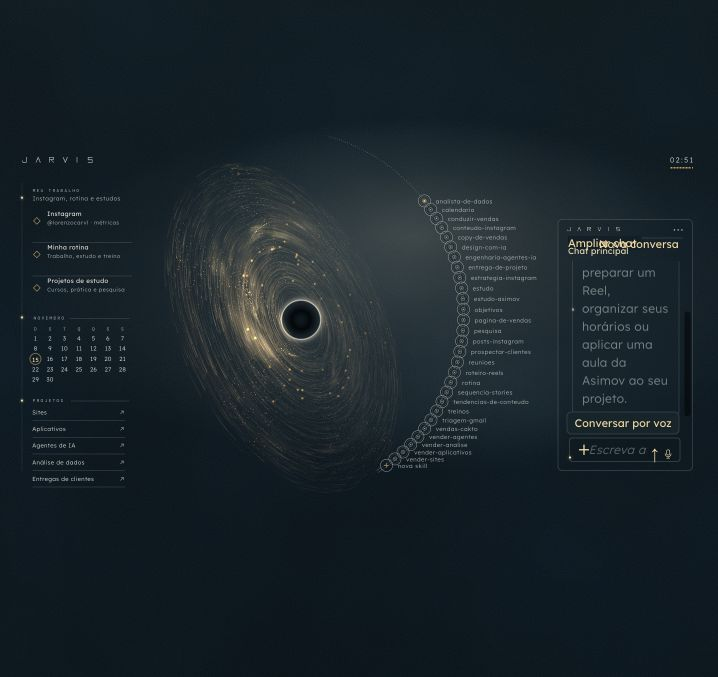
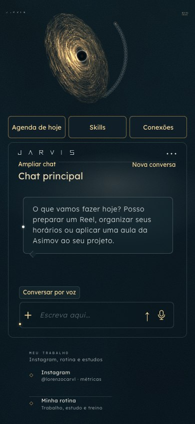

# Jarvis pessoal

Um assistente pessoal que reúne conversas e áreas de trabalho em uma interface própria. Este é um estudo de caso do projeto.

## Problema

Conversas, ideias, referências e tarefas ficavam espalhadas. O objetivo era entrar em uma área de trabalho, conversar sobre aquele contexto e voltar depois sem perder o histórico.

## O que construí

- Interface com chat, navegação por áreas e um disco visual para acessar notas.
- Histórico separado por área e opção de iniciar uma nova conversa.
- Biblioteca de notas em Markdown para memória, projetos, rotinas e referências.
- Envio de imagens como referência em conversas.
- Áreas específicas para projetos, conteúdo, negócios e estudos.
- Integrações opcionais para consultar dados externos, com credenciais guardadas fora dos arquivos públicos.

## Fluxo de uso

1. Escolher uma área, como projetos ou conteúdo.
2. Abrir uma conversa ou uma nota relacionada.
3. Fazer uma pergunta ou enviar uma referência.
4. Continuar a conversa depois, com o histórico da área disponível.

## Decisões de produto

O Jarvis separa os assuntos por área para reduzir a mistura de contextos. As notas são arquivos Markdown legíveis e editáveis. A interface visual ajuda a encontrar o material, enquanto o chat é o caminho principal para trabalhar com ele.

## Estado desta publicação

Esta página apresenta a experiência e o escopo do projeto para clientes conhecerem a proposta. A instalação pessoal, as conversas, as notas privadas, o banco local e as credenciais não fazem parte da demonstração pública.

## Próximos passos

Preparar uma versão de demonstração com dados fictícios e uma instalação reproduzível, separada do ambiente pessoal.
